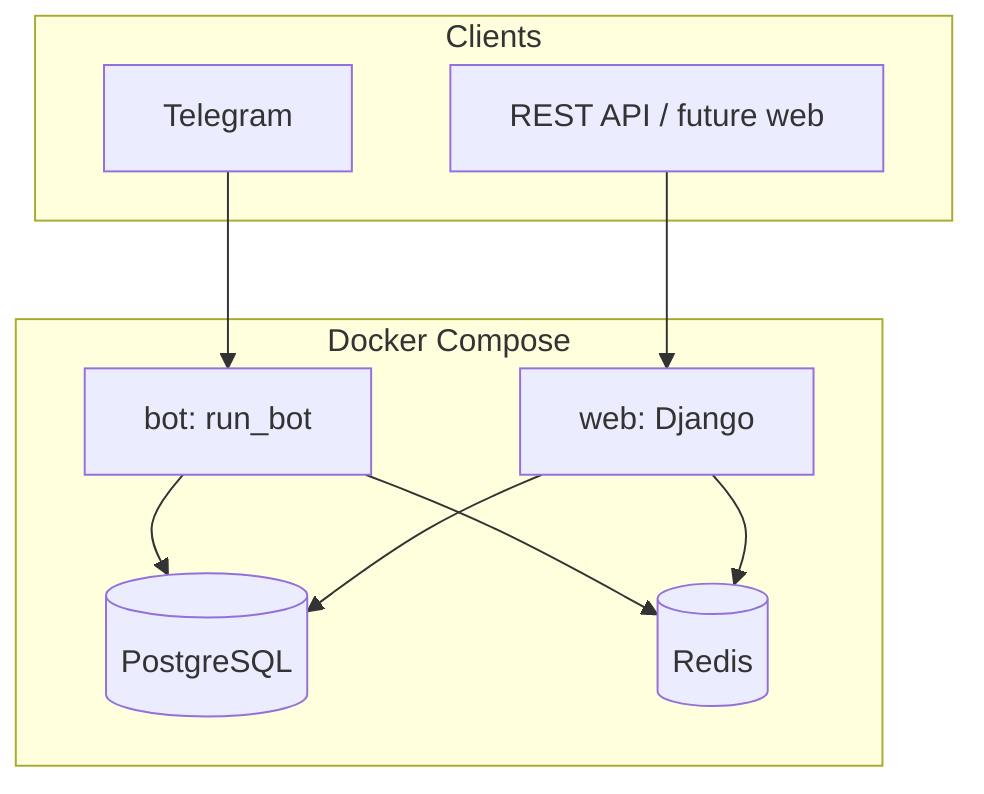
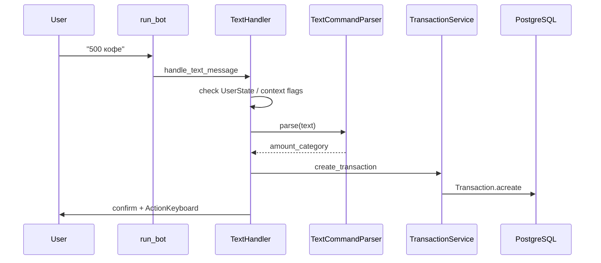
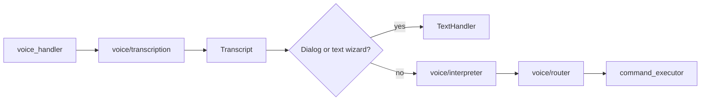

# FinHub — архитектура (agent reference)

## Общая схема



## Telegram: ввод транзакции (текст)



**State machine:** `UserState` + `context.user_data` — editing transaction, goal flow, budget input перехватывают текст до парсера.

## Telegram: handler registration

Файл: `telegram_bot/management/commands/run_bot.py`

| Filter | Handler |
|--------|---------|
| `/start`, `/help`, `/stats`, `/week` | `CommandHandler` |
| `TEXT & ~COMMAND` | `TextHandler.handle_text_message` |
| all callbacks | `CallbackHandler.handle_callback_query` |
| `VOICE \| AUDIO` | `VoiceHandler.handle_voice_message` |

## Слои telegram_bot

```
telegram_bot/
  handlers/       # UI / routing (thin)
  services/       # business logic, DB
  keyboards/      # InlineKeyboard builders
  utils/          # text_parser, admin_alerts, telegram_resilience
  models.py       # TelegramUser, UserState, BotText
  voice/          # Whisper, interpreter, router
```

**Правило:** handlers вызывают services; не дублировать ORM-логику в handlers.

## Voice pipeline

Голос уже работает, за флагом `VOICE_ENABLED`. Это не план.

Вход — `telegram_bot/handlers/voice_handler.py`: скачивает аудио и зовёт Whisper. Разбор и маршрутизация — пакет `telegram_bot/voice/`: `transcription.py`, `interpreter.py` (сначала regex, если не разобрал — LLM JSON), `router.py`. Исполнение — `telegram_bot/services/command_executor.py`: записать операцию, поставить лимит, пополнить / снять / создать цель, ответить на вопрос консультанта.

Если человек уже в текстовом мастере или в голосовом диалоге, транскрипт уходит в `TextHandler`, а не в интерпретатор заново.



Детали: [voice-input.md](voice-input.md)

## Архив категорий

«В архив» не удаляет категорию и не трогает операции. `is_active=False` прячет её из меню, быстрого ввода, голоса и списка лимитов. Текущий и будущий лимит выключаются; прошлые периоды лимита остаются как были. В отчёте категория видна только в месяцах, где по ней были суммы. Вернуть можно из «Архив» или создав категорию с тем же именем — это та же запись.

## Цели и конверты

`Goal.kind`: `savings` — цель с суммой, дедлайном и процентом; `envelope` — конверт без суммы и процента. У конверта на карточке только «лежит / внесено / потрачено». Процент цели считается от накопленного (взносы минус снятия) и не падает, когда из цели что-то покупают. Остаток при этом уменьшается.

«В архив» ставит `status=archived`. Запись пропадает из списка, голоса и кнопки «Из цели». Журнал остаётся, резерв в «свободно» не возвращается, пока деньги не снимут. То же имя и тот же тип при создании возвращает запись из архива. В Excel цели и конверты на разных листах: у цели прогресс, у конверта внесено / потрачено / остаток. Архив с движениями в отчёте остаётся.

## Расход из цели

На карточке любого расхода есть «Из цели». Список показывает активные цели и конверты и остаток. Выбор списывает ту же сумму (`GoalLedgerEntry` типа spend, минус, связь с операцией) и оставляет расход в его категории. «Свободно» не уменьшается второй раз: резерв уменьшается на ту же сумму, что и расход. Если денег меньше, списания нет. «Отмена» операции возвращает деньги. Смена суммы не поднимает расход выше остатка.

## Лимит превышен

После траты, переноса её даты или суммы бот сравнивает факт с живыми лимитами этой категории на эту дату. Сообщение уходит один раз, когда факт становится больше плана. Следующие траты в том же превышенном периоде молчат. То же сообщение, если новый лимит сразу ниже уже потраченного или старый лимит опустили ниже факта. Повторно опускать и без того превышенный лимит не пингует.

## Недельная сводка

Цикл `weekly_digest_loop` в `telegram_bot/services/weekly_digest.py` просыпается каждый день в 09:00 по Вьетнаму (Asia/Ho_Chi_Minh). Итог прошедшей календарной недели (пн–вс) уходит один раз: `already_sent` смотрит отметку в `UserState.context_data['weekly_digest_week']`. Если в понедельник бот не работал, сводка уйдёт на следующее утро в 09:00. `/week` и кнопка «Неделя» показывают неделю, которая ещё идёт. В таблице недели: доход, расход, нетто в цели и конверты, свободно, категории, лимиты (факт за весь срок лимита). Строки «баланс за неделю» нет: под таблицей остаток текущего месяца (доход минус расход с 1-го по сегодня). У цели в сводке тот же срок, что на карточке (`goal_eta`). У конверта только остаток, без процента и срока.

Месячный отчёт — та же статья (`build_month_digest`): доход, расход, баланс месяца, в цели, свободно, категории, лимиты, цели. Кнопки прошлого и следующего месяца шлют новое сообщение, старое не переписывают. Экран «Сегодня» показывает траты за день (доход — только если он был) и ту же строку остатка месяца. День и месяц считаются по Вьетнаму.

Сообщение — статья `sendRichMessage` с HTML-таблицами (`<table bordered striped>`). Вызов через `Bot.do_api_request`, потому что python-telegram-bot 22 метод не оборачивает. Если API отклоняет статью, уходит обычный HTML без таблиц.

## Консультант и срок цели

Вопрос текстом или голосом («сколько потратил», «когда закрою отпуск») идёт в ASK_ADVISOR. Срок цели считает `goal_eta`: средний нетто-взнос за последние 1–3 полных месяца и сумма в месяц до дедлайна. Текущий неполный месяц в темп не входит. Покупка из цели этот темп не уменьшает. Те же строки показываются на карточке цели. У конверта срока нет: в снимке только остаток. Модель только пересказывает поля, сама месяцы не выдумывает.

## Валюта

Отчёты, бюджеты, цели и конверты считаются в базовой валюте пользователя (`TelegramUser.base_currency`, по умолчанию рубли). `Transaction.amount` — итог в этой валюте на момент записи (`report_currency`).

После суммы без пометки бот показывает кнопки из `TelegramUser.input_currencies` (по умолчанию рубли и донги). Если выбрана не базовая валюта, сумма переводится в базовую по кросс-курсу через рубль. Источник — ежедневный XML ЦБ (`https://www.cbr.ru/scripts/XML_daily.asp`, без ключа): доллар, евро, юань, донг и остальные коды котировки. Не чаще одного запроса в московские сутки, курс замораживается на операции. Смена базовой валюты в «Общих настройках» пересчитывает уже записанные суммы по сегодняшнему курсу.

Подробности: [currency.md](currency.md).

## Django models (связи)

```
User 1--* Category
User 1--* Transaction
User 1--* Budget
User 1--* Goal          # kind: savings | envelope; archived прячет из меню
Category 1--* Transaction
Category 1--* Budget
Goal 1--* GoalLedgerEntry
TelegramUser 1--1 User
TelegramUser 1--1 UserState
ExchangeRate — дневной курс валюты к рублю (ЦБ), не привязан к пользователю
```

## API

- Versioning: `core/middleware.py` → header `X-API-Version`
- Auth: Token (djoser)
- Rate limit: `django-ratelimit` на views (prod)

## Production vs development

| | development | production |
|---|-------------|------------|
| Cache | DummyCache | Redis |
| Rate limit | off | on |
| DEBUG | True | False |
| DB SSL | — | `DB_SSLMODE` env |

## Файлы-«god objects» (осторожно при правках)

| Файл | ~строк | Примечание |
|------|--------|------------|
| `handlers/callback_handler.py` | 1600+ | inline callback routing |
| `handlers/text_handler.py` | 1250+ | text + state branches |
| `handlers/settings_handler.py` | 1170+ | categories/settings |

При voice work: выносить shared logic в `services/command_executor.py`.
